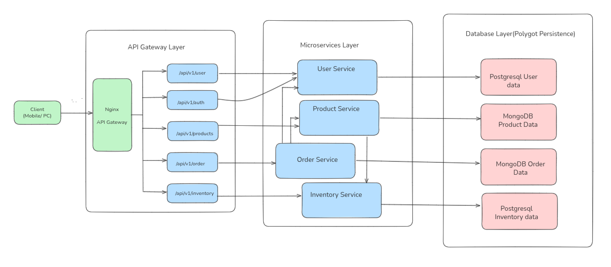

# ShopStream

> A production-ready microservices e-commerce backend built with **Node.js**, **Express**, **PostgreSQL**, **MongoDB**, and **Docker**.

## Architecture



## Quick Start

```bash
cp .env.example .env          # set real values (JWT_SECRET: openssl rand -hex 32)
docker compose up --build -d  # databases + services (Prisma migrations auto-apply)
curl http://localhost:3000/health  # verify gateway
```

Secrets live in `.env` (gitignored); `docker compose` reads them via `${VAR:?}` interpolation and refuses to start without them. Prisma migrations are committed and applied automatically at container startup (`npx prisma migrate deploy`).

## Interactive API Docs (Swagger UI)

```
http://localhost:3000/api-docs
```

Every endpoint of all 5 services in one place, with **Try it out**:

1. `POST /api/v1/auth/register` → `POST /api/v1/auth/login` to get a JWT
2. Click **Authorize** (lock icon, top right), paste the token, Execute
3. Call any protected endpoint — the token is sent as `Authorization: Bearer …`

Raw spec: `http://localhost:3000/openapi.json`

## Smoke Test

```bash
./scripts/smoke-test.sh    # needs curl + jq; creates a throwaway user + product (product deleted at the end)
```

## Services

| Service | Port | Database |
| :--- | :--- | :--- |
| api-gateway | 3000 | — |
| user-service | 3001 | PostgreSQL |
| product-service | 3002 | MongoDB |
| order-service | 3003 | MongoDB |
| inventory-service | 3004 | PostgreSQL |

## Authentication

Mutating endpoints (and private reads) require a JWT from `POST /api/v1/auth/login`:

```bash
curl -X POST http://localhost:3000/api/v1/auth/login \
  -H "Content-Type: application/json" \
  -d '{"email":"john@test.com","password":"pass123"}'

curl -X POST http://localhost:3000/api/v1/products \
  -H "Content-Type: application/json" \
  -H "Authorization: Bearer <token>" \
  -d '{"name":"iPhone 15 Pro","price":999.99}'
```

Public (no token): health checks, product catalog reads, stock lookup, register/login.

Full architecture and API documentation: [ARCHITECTURE.md](./ARCHITECTURE.md)
